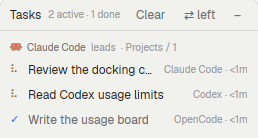
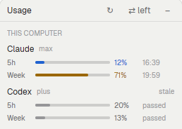
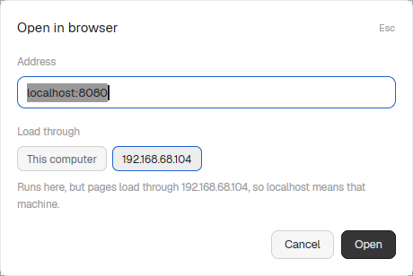

# herdr-mods

Mods for the [Herdr](https://herdr.dev) app, for working with several coding
agents at once.

| Mod | What it shows |
|---|---|
| [`task-board`](task-board/) | **Task board.** Which agent hands out work, which tasks it started, which provider runs each one, for how long, and how it ended. |
| [`usage-board`](usage-board/) | **Usage.** How full each provider's 5-hour and weekly limits are on every Herdr machine, and when they reset. Claude Code and Codex included; OpenCode, which has no limits of its own, shows today's and this week's tokens. |
| [`browser`](browser/) | **Browser.** Opens a web page in a pane beside your agents. Pick another Herdr machine and its `localhost` opens, no port forwarding. |
| [`ports`](ports/) | **Ports.** Which program or container listens on which port, on every Herdr machine, and which terminal started it. Search them, open a page in the browser, jump to its terminal, or stop it. |
| [`machines`](machines/) | **Machines.** CPU, memory, disks and the busiest processes of every Herdr machine, and their Docker containers by project, with logs, start, stop and restart. |
| [`attach`](attach/) | **Add files.** Pick files, or drop them on its window, and they go into an agent's input as paths: images arrive attached like a pasted one. For an agent on another machine the files are sent there first. |
| [`team`](team/) | **Agent team.** Agents in one repository, on one branch or in different worktrees, message each other with the `herdr-team` command. The window shows who works where, the files each worktree changed, clashes, and what the agents said; "Introduce" tells them about each other. |
| [`palette-plus`](palette-plus/) | **Palette.** Herdr's command palette (Ctrl+Shift+P) with a "Mods" group: these panels and any mod you gave a key, with their keys. |
| [`ci`](ci/) | **PRs & CI.** The open pull requests and CI runs of every repository in your spaces, on every Herdr machine, grouped by space. Notifies when a run finishes and shows a failed step's log, ready to copy to an agent. |

<p>
  
  
  
</p>

## Install

```sh
git clone https://github.com/PsyChaos/herdr-mods
cp -r herdr-mods/task-board herdr-mods/usage-board herdr-mods/browser herdr-mods/ports herdr-mods/ci herdr-mods/machines herdr-mods/attach herdr-mods/team herdr-mods/palette-plus ~/.config/herdr-app/mods/
~/.config/herdr-app/mods/palette-plus/sync.sh
herdr-app check ~/.config/herdr-app/mods/task-board
herdr-app check ~/.config/herdr-app/mods/usage-board
herdr-app check ~/.config/herdr-app/mods/browser
herdr-app check ~/.config/herdr-app/mods/ports
herdr-app check ~/.config/herdr-app/mods/ci
herdr-app check ~/.config/herdr-app/mods/machines
herdr-app check ~/.config/herdr-app/mods/attach
herdr-app check ~/.config/herdr-app/mods/team
install -m 755 herdr-mods/team/herdr-team ~/.local/bin/ && herdr-team setup   # on every Herdr machine
herdr-app check ~/.config/herdr-app/mods/palette-plus
```

The browser mod also needs [terminal-browser](https://github.com/zenbu-labs/terminal-browser)
on this computer (Linux or macOS):

```sh
curl -fsSL https://terminal-browser.sh/install | bash
```

Then add the keys from each mod's `keys.json` to `~/.config/herdr-app/keys.json`
(check you don't already use them):

```json
"global": {
  "ctrl-shift-g": "mod.open:task-board",
  "ctrl-shift-j": "mod.open:usage-board",
  "ctrl-shift-u": "mod.open:browser",
  "ctrl-shift-y": "mod.open:ports",
  "ctrl-shift-r": "mod.open:ci",
  "ctrl-shift-m": "mod.open:machines",
  "ctrl-shift-a": "mod.open:attach",
  "ctrl-shift-d": "mod.open:team",
  "ctrl-shift-p": "mod.open:palette-plus"
}
```

`Ctrl+Shift+G` and `Ctrl+Shift+J` now open each panel as a window you can drag
anywhere; it comes back after a restart until you close it. `Ctrl+Shift+U`
asks for an address to open, `Ctrl+Shift+Y` lists the ports, `Ctrl+Shift+R` shows PRs and CI, and
`Ctrl+Shift+M` the machines, `Ctrl+Shift+A` adds files to an agent, and `Ctrl+Shift+D` shows your agents by repository. `Ctrl+Shift+P` replaces Herdr's palette with one
that lists all of these.

An agent in Herdr can do all of this for you: ask it to add the mods from this
repository. Each folder has a `RECIPE.md` it can follow.

### Dock them in the sidebar (optional)

Herdr's own layouts are read-only, so dock the panels in a copy of the main
layout:

```sh
herdr-app do layout.clone '{"name":"main","as":"my-main"}'
```

In `~/.config/herdr-app/layouts/my-main.json`, add these blocks to the
`children` of the node with `"id": "sidebar-lists"` (under Spaces and Agents):

```json
{ "id": "tasks", "type": "block", "size": { "weight": 1 }, "min": 90, "content": { "mod": "task-board" } },
{ "id": "usage", "type": "block", "size": { "weight": 1 }, "min": 90, "content": { "mod": "usage-board" } }
```

Each docked panel gets "⇄" to move between the left sidebar and the right of
the work area, and "–" to hide it. To toggle them with keys in that layout:

```json
"layout:my-main": {
  "ctrl-shift-g": "layout.toggle:tasks",
  "ctrl-shift-j": "layout.toggle:usage"
}
```

`Ctrl+Shift+L` switches back to Herdr's own layout. A copied layout doesn't
receive Herdr's later changes to the main layout.

## Using the task board

A task is any terminal an agent starts with `hc run`, whichever provider
either of them is. Herdr records who started it, so the board needs no setup.
The title is the first sentence of the prompt the helper got:

```sh
hc run --bg --name review codex "Review src/auth. Report with hc send $HC_TERMINAL_ID when done."
```

shows as "Review src/auth." under the agent that ran it. A `task` label sets
the title yourself (`--label task="Review the auth module"`). Click a running
task to jump to its agent.

The board only sees helpers started through Herdr. Sub-agents a provider runs
inside its own process (Claude Code's or Codex's built-in ones) don't show.

## Using the browser

`Ctrl+Shift+U`, type an address (`example.com`, `localhost:3000`, or just
`3000`) and press Enter. The page opens in a pane to the right; Ctrl+Q in the
browser closes it.

"Load through" starts as the machine of the space you're in. The browser always
runs on this computer, where Herdr draws it, so it stays smooth. With another
machine chosen, terminal-browser loads pages through it over ssh (`--ssh`), so
`localhost` means that machine: a dev server running there opens as it is. This
needs ssh to that machine without a password prompt.

A file path works too: `~/report.html`, `/tmp/screenshot.png`, a PDF, or a folder
for its listing. The file is read on the "Load through" machine. The mod starts
a small web server there (`python3 -m http.server`, bound to `127.0.0.1` only)
in the file's folder, so a page's own images and styles load with it, and opens
that. The server stops when the browser pane closes, and after 12 hours at the
latest. While it runs, other local users of that machine could read the folder
too.

## Using the ports panel

`Ctrl+Shift+Y` lists what you or your agents started: containers, and
programs running in a folder under your home. "Show all" adds system ports and
ones programs picked for themselves. Type to search all of them by port,
program, container, folder or machine (`3000`, `node miloobi`, `5432`); Enter
opens the first match in the browser.

"Open" loads the page with the browser mod, through the port's machine. "My
browser" opens it in your own browser; a port on another machine gets an ssh
tunnel to the same port here first (or one above 40000 when that is taken),
shown under the row with "Close tunnel".
"Terminal" goes to the Herdr terminal the program was started in. "Stop"
ends the program or container behind a port, after a confirmation that says
what else stops with it; "Force stop" is offered only when it doesn't stop. "network"
marks a port other computers can reach, not only its own machine.

## Using the PRs & CI panel

`Ctrl+Shift+R` lists, under each space, the open PRs of the repositories its
terminals are in, with their checks, and the latest CI runs of the branch you
have checked out. Type to search (`vensift fail`, `#64`, `dependabot`). Once it has
been opened, it notifies you when a run finishes, even with the window closed
("Turn off" in its footer stops that). "Log" on a
failed PR shows the failed step's end; "Send to an agent" leaves it, with the
link, in the input of that space's agent, unsent: you read it and press Enter.
"Copy" puts the same message on the clipboard. "Open" opens the PR in
your own browser. It needs [`gh`](https://cli.github.com) logged in on each
machine.

## Using the machines panel

`Ctrl+Shift+M` shows how full each machine's CPU, memory, swap and disks are,
what is busiest right now, and its Docker containers by compose project. A
project with an unhealthy, crashed or restarting container opens by itself in
red. "Logs" shows a container's last lines; "Stop" and "Restart" ask first.

## Adding files to an agent

`Ctrl+Shift+A` opens a small window. Pick the agent (the one you were in is
chosen), press "Choose…" or drop files from your file manager on the window,
then "Add to …". Each file's path is pasted into the agent's input, unsent:
Claude Code and Codex show a pasted image path as an attached image
(`[Image #1]`) and read other files from their path. Write your message and
press Enter yourself. "Choose…" needs `zenity`; dropping works without it.

## Letting your agents talk to each other

Agents working in one repository, on the same branch or in different
worktrees, can message each other from the shell:

```sh
herdr-team who                      # the agents in this repository
herdr-team say t3n "I'm changing auth.ts; leave it to me"
herdr-team say all "main is broken after my merge, don't pull yet"
herdr-team log                      # what was said
```

A message is typed into the other agent's input and submitted, so it arrives
as a new message (`hc send`: it waits while you type there and skips an agent
waiting on a permission dialog). Every message also goes to the repository's
log, `.git/herdr-team.md`, which git never commits.

`herdr-team setup` teaches your agents to do this on their own: it adds a short
set of rules to Claude Code's `~/.claude/CLAUDE.md` (as `@HERDR-TEAM.md`) and to
the `AGENTS.md` of Codex, OpenCode and Pi, where they are installed and the
rules are missing. With them, an agent runs `herdr-team who` when it starts
work, tells the others before touching their files, and starts helpers that
others must reach as Herdr terminals (`hc run --bg … claude "<task>"`) instead
of hidden built-in subagents. Agents already running read the rules only in
their next session: `herdr-team introduce` runs `setup` and also tells every
agent in the repository, by message, who the others are and how to reach them.

`setup` also adds a session-start hook to Claude Code and Codex
(`herdr-team hook`), and a small plugin doing the same to OpenCode: when a new
session opens in a Herdr terminal inside a git repository, the agent starts
with the list of agents working there, without having to remember to ask. Codex asks you once to trust the new hook
("Hooks need review"); after that it runs on its own.

`Ctrl+Shift+D` opens the Agent team window: under each repository, its
worktrees and branches, the agents in each, and the files they changed.
"Introduce" runs `herdr-team introduce` there. The "Messages" tab is an inbox
of what the agents said to each other: projects on the left, each with its
conversations (one per pair of agents, and "Everyone"), unread ones in bold;
click one to read it. The search box finds a repository, branch, agent
(`t3n`) or file under "Agents", and a message under "Messages". When two agents share one folder, or two worktrees
change the same file, a red box says so and "Tell them" sends the warning to
those agents. "Messages" shows what they said to each other.

Agents started with `hc run` are terminals and take part; subagents a coding
agent starts inside itself are not and can't be reached.

## Adding a provider to the usage panel

Put a script in `usage-board/sources/<provider>.sh` that prints one line of
JSON as described in [`CONTRACT.md`](usage-board/CONTRACT.md). The panel
picks it up on the next refresh and runs it on every machine.

## What these mods do on your machine

- **task-board** runs `hc get` and `hc rm` on finished task terminals and
  keeps up to 50 finished tasks in Herdr's shared state. No network access.
- **usage-board** runs its `sources/*.sh` scripts every 2 minutes, here and
  on each connected Herdr machine (the script text is sent and run there;
  nothing is installed).
  - `claude.sh` reads your Claude Code login (`CLAUDE_CONFIG_DIR` or
    `~/.claude*/.credentials.json`) and sends its access token only to
    `https://claude.ai/api/oauth/usage`, the endpoint Claude Code's `/usage`
    uses. The token is never printed, stored or refreshed. This endpoint is not
    documented and may change.
  - `codex.sh` only reads `~/.codex/sessions`. No network access.
  - `opencode.sh` runs `opencode stats --standalone` (OpenCode's own
    statistics, from its local database). Machines without OpenCode get no row.

Both need `python3`.

- **ports** runs a short Python script every 10 seconds, here and on each
  connected Herdr machine (sent with `hc exec`, nothing is installed). It
  reads `ss -ltnp`, `docker ps`, and `/proc` for your own processes' command,
  folder and Herdr terminal. It needs `python3`. Only "Stop", after you
  confirm, changes anything: `kill` or `docker stop` on that machine. "My
  browser" for another machine starts `ssh -N -L` to it as a Herdr terminal
  (ending after 12 hours at the latest) and opens your browser.

- **ci** runs a Python script every minute (every 20 seconds while CI runs),
  from an invisible 2×2 px window that stays open after you first open the
  panel (the open panel runs its own as well), here and on each
  connected Herdr machine (sent with `hc exec`, nothing is
  installed). It reads `git` in your spaces' folders and calls that machine's
  `gh` (`gh pr list`, `gh run list`, and `gh run view --log-failed` when you
  ask for a log), so it uses that machine's GitHub login and API limits. It
  never writes to GitHub. "Open" runs `xdg-open` (`open` on macOS); "Copy for
  an agent" runs `wl-copy`, `xclip` or `pbcopy`.

- **machines** runs a Python script every 10 seconds, here and on each
  connected Herdr machine (sent with `hc exec`). It reads `/proc`, `statvfs`,
  `docker ps -a` and `docker stats`. No network access. Only "Start", "Stop"
  and "Restart" (the last two after you confirm) change anything: `docker
  start|stop|restart` on that machine.

- **attach** runs `zenity` for "Choose…", and `hc put` to copy a file next
  to an agent on another machine (or a local file whose name has spaces or
  quotes, so it gets a plain name). It pastes through the clipboard
  (`wl-copy`, `xclip` or `pbcopy`) and, with `wl-paste`, saves the clipboard
  first and puts it back. No network access beyond Herdr's own connection.

- **team** runs a Python script every 8 seconds while its window is open, here
  and on each connected Herdr machine (sent with `hc exec`, nothing is
  installed). It reads `git` in your agents' folders without taking git's
  locks, and each repository's `.git/herdr-team.md`. "Introduce" and "Tell
  them" run `hc send`; "Clear" empties the log. `herdr-team` runs `hc ls`,
  `hc get` and `hc send` on its own machine, appends to that log and keeps
  `~/.local/state/herdr-team/members.json` (which agent last used it where)
  and `repos.json` (which repositories have a log).
  `herdr-team setup` (and `introduce`) adds its rules to `~/.claude/CLAUDE.md`
  (plus `~/.claude/HERDR-TEAM.md`) and to Codex's, OpenCode's and Pi's
  `AGENTS.md`, only when they are missing; it never changes them afterwards.
  It also adds a `SessionStart` entry running `herdr-team hook` to
  `~/.claude/settings.json` and `~/.codex/hooks.json`, unless one is there,
  and `~/.config/opencode/plugins/herdr-team.js`, which runs that command on a
  session's first request and adds its output to the session's instructions.

- **palette-plus** copies Herdr's own palette next to itself with `sync.sh`
  when Herdr's changes, and only opens mods.

- **browser** runs `terminal-browser` on this computer when you open a page,
  with its usage statistics turned off (`DO_NOT_TRACK=1`). For another
  machine it connects with ssh. On its first start terminal-browser adds a
  skill for agents to `~/.claude/skills`, `~/.codex/skills` and
  `~/.agents/skills`; delete those links if you don't want agents to use it.
