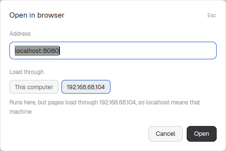

# Browser

Opens a web page, or a file (HTML, image, PDF, a folder's listing), in a pane,
next to your terminals and agents, with
[terminal-browser](https://github.com/zenbu-labs/terminal-browser): a real
Chromium drawn inside a terminal. For a Herdr machine on another computer, the
page loads through that machine, so its own `localhost` (a dev server) opens
without port forwarding, and a file opens from that machine's disk.

## What you see

A dialog, 460px wide, on `popover`:

- "Open in browser" in 15px semibold, "Esc" in 11px `dim` on the right.
- "Address or file" label (11.5px `dim`) and a 36px input with an `accent`
  border, placeholder "localhost:3000, an address, or a file path
  (~/page.html)". It holds the last address you opened, selected.
- "Load through": a chip per machine, "This computer" first, then each
  machine in `machines()`. The chosen one has an `accent` border on `selected`.
- One 11.5px `dim` line saying where the page runs and loads from; for a file
  path, that it is shown through a temporary local server that stops with the pane.
- Errors in `blocked`: terminal-browser missing (with the install command),
  a file that doesn't exist, or why the browser didn't start.
- "Cancel" and "Open" (primary, "Opening…" while it starts).

## How it behaves

- The machine starts as the focused space's machine (`spaces()[i].machine`).
- Enter or "Open" runs, here:
  `hc run --bg --json -- env DO_NOT_TRACK=1 TERMINAL_BROWSER_NO_TELEMETRY=1 terminal-browser open --no-merge [--ssh <target>] <address>`.
  `<target>` is the machine's `target` from `hc machine ls --json`.
- The browser always runs on this computer, where Herdr draws it. With
  `--ssh`, terminal-browser sends its requests through that machine over ssh.
  Running it on the other machine instead would send every frame over the
  network.
- Input starting with `/`, `~`, `./` or `../` is a file on the chosen machine.
  `hc exec [--on m] sh -c` resolves it (a leading `~` is that machine's home)
  to its folder and name. `hc run --bg --no-parent --no-notify [--on m] --
  timeout 12h python3 -c <server> <folder>` serves that folder on `127.0.0.1`
  at a free port and prints it; `hc wait --output "serving port"` and `hc read`
  give the port. The browser opens `http://127.0.0.1:<port>/<name>`, which with
  `--ssh` is that machine's localhost. Serving the folder, not just the file,
  lets a page's own images, styles and fonts load.
- For a file, the browser runs as `env SERVER=<server address> sh -c <script>
  sh terminal-browser ...`: the script's EXIT trap runs `hc kill` and `hc rm`
  on the server, and HUP/INT/TERM exit through it, so closing the pane or
  Ctrl+Q stops the server. `timeout 12h` is the backstop.
- It waits until `terminals()` lists the new terminal, focuses the pane that
  was focused when the dialog opened, then `terminal.keep {place: "right"}`.
  If no pane shows up for it (focus on a layout block, which has no pane, makes
  "right" fail with a "keep.failed" toast), it runs `terminal.keep` without a
  place, so the browser gets its own tab. If that fails too, it ends the browser
  and its server and says so. Ctrl+Q in the browser ends it and closes its pane.
- The address is kept in shared state `browser.last-url`.
- Another mod can ask for a page: shared state `browser.request` set to
  `{url, machine, at}`, then `mod.open browser`. A request younger than 5
  seconds is cleared, its machine chosen and its address opened at once (the
  [ports](../ports/) mod's "Open").

## Built from

- `main.js`: the dialog; `mod.json`: `place: none`, a dialog overlay 460px wide.
- Herdr: `focused()`, `spaces()`, `machines()`, `terminals()`, `panes()`,
  `hc([...])`, `exec("sh", ["-c", "command -v terminal-browser"])`,
  `run("pane.focus" | "terminal.keep")`, `shared`/`setShared`,
  `props().overlay`/`closeOverlay`.
- gpui-base `InputState` + `Input`.

## Watch out

- `terminal.keep` right after `hc run` fails with "no running terminal": Herdr
  sees the new terminal a moment later. Wait for it in `terminals()` first.
- `terminal.keep` finishes in the background: a failure is only a toast, never
  an error from `run`. Check `panes()` for the terminal instead, and never leave
  a browser running without a pane.
- `hc wait --timeout` exits 0 when it only checks in, so read the output to know
  whether the server is up.
- While a file is open, its whole folder is readable at that port by anyone
  logged in on that machine (it listens on `127.0.0.1` only).
- `--ssh` needs ssh to the machine to work without a password prompt
  (keys or an agent), since nobody can type into it.
- terminal-browser's first start adds a skill for agents under
  `~/.claude/skills`, `~/.codex/skills` and `~/.agents/skills` (links to its
  own folder). Delete them if you don't want agents to use the browser.

## Done when

- `herdr-app check` passes.
- Ctrl+Shift+U, `example.com`, Enter: the page opens in a pane to the right.
- With another machine chosen and a server on its `localhost:<port>` that
  this computer doesn't have, `<port>` opens that machine's page.
- A path such as `~/page.html` on the chosen machine opens with its images, and
  after the pane is closed no `http.server` is left running there.
