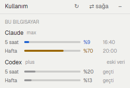

# Kullanım panosu

A compact usage panel: for every provider and every Herdr machine, how full
the 5-hour and weekly limits are and when they reset. Ships with readers for
Claude Code and Codex; any provider can be added as one shell script. The
interface text is Turkish.

## What you see

- **Header** (32px, bottom border): "Kullanım" 12px semibold, a braille
  spinner while reading, then "↻" (refresh) and "✕" (window) or
  "⇄ sağa"/"⇄ sola" and "–" (docked). Buttons never shrink.
- **Machine groups**: "BU BİLGİSAYAR" or the machine name, 10px uppercase `dim`.
- **Provider rows**: name 12px semibold, plan in 10px `dim`, and on the right
  only a note that matters: "eski veri" (every window stale), the data's age
  when older than 30 minutes, "bağlanıyor…", or the error in `blocked`.
- **Window lines** (10px): label ("5 saat", "Hafta") 34px, a 4px bar that fills
  in proportion, the percent 34px, the reset clock 46px ("16:40" today,
  "9.11." another day, "geçti" when past).

## How it behaves

- Color by percent: above 80 `blocked`, above 50 `working`, else `accent`;
  stale windows are `dim`.
- Reads every 2 minutes (`cx.timer.every`) and on "↻"; the clock re-renders
  every 30 s.
- For each `sources/<provider>.sh` and each machine in `machines()`: this
  computer runs the file with `exec("sh", [path])`; another machine gets the
  script's text with `exec("sh", ["-c", text], { on: machine })`, so nothing is
  installed there. Unavailable or loading machines show "bağlanıyor…".
- Each script prints one JSON line (see `CONTRACT.md`); a missing script, bad
  JSON or `ok: false` becomes a readable one-line error, never a crash.
- Docked: "⇄" moves the block between the left sidebar and a 260px card right
  of the work area (`layout.set`); "–" hides it (`layout.hide`).

## Built from

- `main.js` (view), `dock.js` (block id `usage`), `mod.json` (`place: none`,
  kept 420×420 px window, `key: kullanim-panosu`), `CONTRACT.md`,
  `sources/claude.sh`, `sources/codex.sh`.
- `sources/claude.sh`: reads the Claude Code login from `CLAUDE_CONFIG_DIR`, or
  the `~/.claude*` folder whose `.credentials.json` changed last, and asks
  `https://claude.ai/api/oauth/usage` (what Claude Code's `/usage` shows) with
  that OAuth access token. Read-only: the token is never printed, refreshed or
  written; an expired token gives `ok: false` until Claude Code runs again.
- `sources/codex.sh`: reads the newest `token_count` event with real windows
  (`limit_id` "codex"; "premium" entries carry no windows) from
  `~/.codex/sessions/YYYY/MM/DD/*.jsonl`; `primary` is 5 h, `secondary` the
  week. Marks a window `stale` once its reset time has passed.
- Herdr: `machines()`, `exec`, `readTextFile`, `appHome()`, `theme()`,
  `props().overlay`/`closeOverlay`, `layout()`, `run("layout.set"|"layout.hide")`.

## Watch out

- The Claude endpoint is undocumented and may change. It refuses requests
  without a User-Agent (403); the script sends `kullanim-panosu/1.0`.
- Codex only records limits when it runs, so a machine where Codex is idle shows
  old numbers; that's what `stale` and "eski veri" are for.
- The mod runtime's `fs` has no `readdir`; list `sources/` with `exec("sh", …)`.
- Overlay `width`/`height` of 1 or less are a share of the window, not pixels.
- `.children()` needs an array; a single element throws "value is not iterable",
  and `herdr-app check` doesn't render data rows, so test with real data.
- After editing, an open copy may keep the old code silently; toggle the window
  or remove and re-add the block.
- `dock.js` expects the main layout's `sidebar-lists` and `work-body` ids;
  dock it in a personal layout (`layout.clone`), shipped ones are read-only.

## Done when

- `herdr-app check` passes and `sh sources/claude.sh` / `sh sources/codex.sh`
  each print one JSON line and exit 0, also with the login or `~/.codex`
  missing (`ok: false`).
- The panel shows a row per provider and machine, with bars matching the
  scripts' percentages and the reset clock in local time.
- A script that prints invalid JSON shows a one-line error on its row while the
  others keep working.
