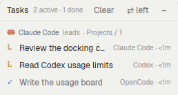

# Task board

A task board for agents handing work to other agents. When a lead agent starts
helpers with `hc run`, the board lists each one under the agent that started
it, with the provider doing it (Claude Code, Codex, OpenCode…), how long it has
run and how it ended. It works with any provider and needs no setup: Herdr
records who started each terminal.

## What you see

- **Header** (32px, bottom border `border`): "Tasks" in 12px semibold, then
  "N active · M done" in 10px `dim` that truncates first when narrow, then
  buttons that never shrink: "Clear" (only when something finished), and
  either "✕" (window) or "⇄ right"/"⇄ left" and "–" (docked).
- **Groups**: one per lead (the tasks' parent terminal). A 10px `dim` line:
  lead's program icon (12px), its name in `muted` semibold, "leads",
  "· <space / tab>" from the task's `where` label. Tasks without a parent
  group under "No lead".
- **Rows**: one 12px line per task: a 12px glyph, the title (truncates),
  and on the right in 10px "<provider> · <duration>". Live rows are clickable
  (hover `hover`).
- Empty: "No tasks yet." and a 11px hint about `hc run`.

## How it behaves

- Status glyph and color (`theme()[status]`): working/running → braille spinner
  (`.frames`, 90 ms) in `working`; blocked → ● `blocked` and the word
  "needs you"; idle → ● `idle`; finished → ✓ `done`; failed (non-zero
  exit) → ✗ and "failed"; stopped (signal, unknown exit, or killed while
  working) → ● and "stopped". A task killed after it went idle counts as
  finished (OpenCode exits 0 when killed, so hc's `reason: killed` decides).
- Order: groups by their most urgent task; inside a group blocked/failed first,
  then working, done, idle, finished; newest first within a rank.
- Click a live row: `pane.focus {terminal}` if it has a pane, else
  `terminal.peek`.
- Finished tasks leave `terminals()`. The board remembers every live task it
  sees; when one disappears it runs `hc get <address>` once and stores the
  result (exit code, signal, reason, finish time, last status) in shared state
  `task-board.finished` (newest 50). "Clear" clears those and runs
  `hc rm` for each.
- Durations re-render every 30 s (`cx.timer.every`); nothing else polls.
- Docked: "⇄" moves the block between the left sidebar (under the agents list)
  and a 260px card right of the work area by rewriting the shown layout
  (`layout.set`); "–" runs `layout.hide`.

## Built from

- `main.js`: the view; `dock.js`: dock side detection and moves; `mod.json`:
  `place: none`, a kept 460×520 px window overlay (`key: task-board`).
- Herdr: `terminals()` (labels, parent, state, status, program, created_ms),
  `agents()` (status), `panes()`, `shared`/`setShared`, `run` (`pane.focus`,
  `terminal.peek`, `layout.set`, `layout.hide`), `exec("hc", ["get"|"rm", …])`,
  `props().overlay`/`closeOverlay`, `layout()`.
- A task is any terminal with a `parent` (started by another one with
  `hc run`), or with a `task` label. Title: the `task` label; else the first
  sentence of the longest argument containing a space (the agent's prompt),
  80 characters at most; else the terminal's name or command. Kept in the
  history entry as `board_title`.
- A lead can still set the title and role:
  `hc run --bg --name <slug> --label task="<title>" --label role=<role> <agent> "<task>"`.

## Watch out

- Overlay `width`/`height` of 1 or less are a share of the window, not pixels.
- `.children()` needs an array; a single element throws "value is not
  iterable", and `herdr-app check` won't catch it when no rows exist.
- After editing, an open copy (window or docked block) may keep running the old
  code without an error. Toggle the window, or remove and re-add the block.
- `dock.js` expects Herdr's main layout ids `sidebar-lists` and `work-body`;
  the docked block id is `tasks`. Shipped layouts are read-only: dock it in a
  personal layout (`layout.clone`).
- The mod runtime's `fs` has no `readdir`/`appendFile`; use `exec`.

## Done when

- `herdr-app check` passes.
- From an agent's terminal, `hc run --bg -- sh -c 'sleep 3' sh "Try the board. More text."`
  shows a spinner row "Try the board." under that agent, then ✓ after it ends; `exit 1` shows ✗ "failed";
  `hc kill` on a running one shows "stopped".
- "Clear" empties the finished rows; docked "⇄" moves the board and the
  button flips to the other side.
